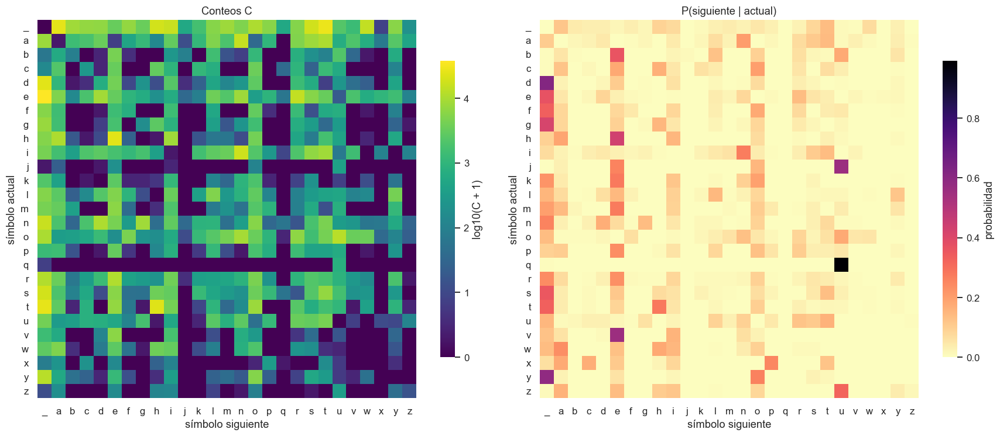
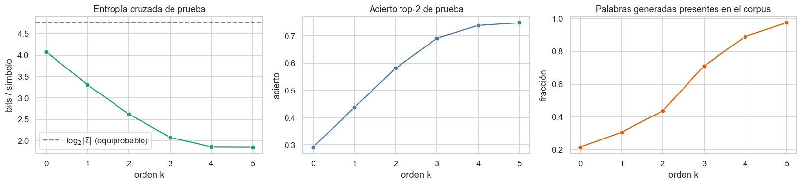

# Teorema de Bayes con letras

Taller de *Métodos de Machine Learning en Ciencias e Ingenierías* (2026A), Universidad del Quindío.
Autores: Juan Esteban Martinez Herrera · Juan David Cuartas.

Modelo de lenguaje a nivel de carácter sobre *Crimen y castigo*: se estima por conteo la matriz P(c<sub>n+1</sub> | c<sub>n</sub>) de 27 × 27 símbolos (a–z y espacio) y se usa para predecir, generar texto, verificar el teorema de Bayes y analizarla con SVD.

## Contenido

| Ruta | Descripción |
|---|---|
| `notebooks/bayes_letras.ipynb` | Cuaderno completo (ejercicios 1–5 y extensión de orden k) |
| `figures/` | Figuras de la ejecución con el libro completo |
| `presentacion/` | Diapositivas de la exposición (10 min) |
| `data/` | Instrucciones para obtener el corpus |
| `requirements.txt` | Dependencias |

## Uso

```bash
python -m venv .venv && source .venv/bin/activate
pip install -r requirements.txt
# colocar crimen_y_castigo.epub junto al cuaderno (ver data/README.md)
jupyter lab notebooks/bayes_letras.ipynb
```

## Ejercicios

1. Matriz de transición P a partir de 1 082 694 símbolos.
2. Agente predictor top-2: ≈ 44 % de acierto frente a ≈ 29 % (letras más frecuentes) y ≈ 7 % (azar), con partición 90/10.
3. Generación de 200 letras: reproduce p(c) (distancia TV ∝ L<sup>−0,5</sup>) y mejora la forma de las palabras, sin producir frases con sentido.
4. Bayes: P(A|B) por columnas y por Bayes coinciden hasta 1,1 × 10⁻¹⁶. Es una identidad algebraica; se añade validación fuera de muestra.
5. SVD: 5 de 27 componentes retienen el 90 % de la energía; el vector propio de λ = 1 es la marginal.

## Extensión: contexto de orden k

Entropía cruzada de prueba (bits): 4,07 · 3,31 · 2,63 · 2,08 · 1,855 · 1,851 para k = 0…5. Los valores de k = 0 y 1 son coherentes con Shannon (1951). A partir de k = 4 el modelo tiende a memorizar el texto de entrenamiento.

## Figuras



